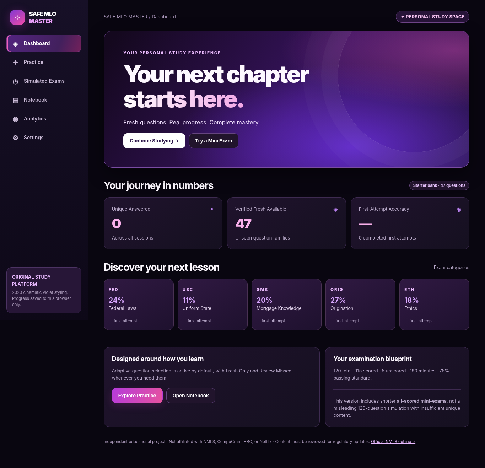

# SAFE MLO Master

**A cinematic pink-and-purple, independent SAFE MLO study application.** A working, zero-dependency, GitHub Pages-ready starter release you can upload directly to GitHub. This is not an official NMLS product and does not reproduce CompuCram content.



## Working in v0.1.0

- Premium dark-violet/pink dashboard, responsive desktop and iPhone navigation.
- **47 original, source-linked starter questions** across FED, USC, GMK, ORIG and ETH. Includes 10 math calculation questions, with by-hand steps.
- **Fresh Only:** excludes all questions or equivalent families already shown in any study session.
- **Review Missed:** selects only previously missed questions.
- **Adaptive (default):** prefers approximately 75% unseen / 25% deliberate review, adjusted to available questions.
- Question styles: **Test Day**, **Mixed**, **Impossible** (the harder style uses only level-3 questions and therefore has limited capacity in the starter bank).
- Math frequency: **Normal** and **Fewer**. These are practice customizations, not official exam math distributions.
- Four answer choices, answer explanations, definitions, reasoned distractor analysis, exam triggers, and mnemonic cues.
- **Timed mini-exams** with navigation, flagged questions, a countdown, delayed answers, and summary scoring. Mini-exam time is proportional to 190 minutes for 120 questions.
- Question history, verified-fresh-available dashboard counter, unique answered count, first-attempt accuracy and category analytics.
- Save question notes or write your own. Notebook preview prints **two ordinary notes per page** or **one math question per dedicated page**, with configurable page size and ruling.
- Browser print/Save as PDF, JSON backup and restore, and persistently saved local history.

## Important limits

This is a **working front-end MVP**, not the finished production platform described in the long-term specification. It has 47 starter questions rather than a validated 1,000+ question bank. **A full 120-question practice exam is deliberately disabled**, since it would require more than 120 independently verified unique questions to provide meaningful freshness and correct distribution. Mini-exams are all scored; the five unscored pretest items are only part of the actual full-length exam format.

Progress is saved using browser `localStorage`: there is no account, hosted database, multi-device sync, administrator review console, AI question generation, or secure backend yet. A **future PostgreSQL data model** is included in `db/schema.sql` but is not wired to the static application.

The starter bank includes links to official topic sources for further review. It has been checked for schema consistency but **has not been independently professionally validated**; laws change, and the app's readiness classifications are illustrative rather than proof of passing. Do not treat the starter question count as equivalent to a comprehensive regulatory review.

**Font:** Netflix Sans is proprietary and is **not bundled**. The UI uses Montserrat/Inter alternatives. HBO Max (2020) influenced the dark cinematic atmosphere, but no HBO/Netflix branding, assets, or copyrighted code is included.

## Upload to GitHub — fastest method (no coding tools needed)

1. Sign in at [GitHub](https://github.com/) and select **New repository**.
2. Set the repository name to `safe-mlo-master`, choose **Public**, and create the repository. You can choose Private for source privacy, but GitHub Pages availability depends on your plan.
3. On the new repository page, choose **Add file → Upload files**.
4. Unzip the downloaded project and upload **all files and folders in the `safe-mlo-master` folder**, so `index.html` is at the repository root. GitHub's browser uploader supports dragging files/folders in modern desktop browsers. If uploading from a phone proves awkward, use GitHub Desktop or the Git command line.
5. Commit the files to the default branch (`main`).
6. Open **Settings → Pages**. Under **Build and deployment**, choose **Deploy from a branch**, select `main` and `/(root)`, then **Save**.
7. Once GitHub publishes it, your app should be available at `https://YOUR-GITHUB-USERNAME.github.io/safe-mlo-master/`.

If you upload via Git rather than the web uploader:

```bash
cd safe-mlo-master
git init
git add .
git commit -m "Initial SAFE MLO Master release"
git branch -M main
git remote add origin https://github.com/YOUR-GITHUB-USERNAME/safe-mlo-master.git
git push -u origin main
```

The example URL is **not** a live site until you publish the repository.

## Run locally

You do not need to install project dependencies. You do need a local web server because the application uses native JavaScript modules:

```bash
cd safe-mlo-master
python3 -m http.server 8000
```

Open `http://localhost:8000`. Do not double-click `index.html` expecting the browser's `file://` mode to reliably load ES modules.

## Tests

Requires Node.js 20 or newer:

```bash
npm test
npm run check
```

The `.github/workflows/ci.yml` workflow runs the JavaScript checks/tests on pushes and pull requests.

## Exam reference

Based on the [official NMLS test outline](https://mortgage.nationwidelicensingsystem.org/knowledge/products/nmls/pubs/testingHbk/education/mlo_testing/mlo_test_faq/mlo_testing_hbk_testOutline.html):

| Area | Weight |
| --- | ---: |
| Federal mortgage-related laws (FED) | 24% |
| Uniform state content (USC) | 11% |
| General mortgage knowledge (GMK) | 20% |
| Mortgage origination activities (ORIG) | 27% |
| Ethics (ETH) | 18% |

Official format: **120 questions (115 scored + five unscored), 190 minutes, 75% passing standard.** The actual test can change with law updates and NMLS requirements.

## Expand this project next

Suggested path: implement independent legal/editorial content review and a genuinely large question bank; add backend authentication and database, online backup, server-side duplicate locks, true weighted 120-question simulations, controlled unscored pretest items, better adaptive spacing and validated readiness models. `db/schema.sql` outlines the backend data structure but should not be deployed without security review and migrations.

## Copyright / use

Original educational app code and example questions; no proprietary third-party questions or trademarked visual assets. Intended for personal educational use. Verify legal content before broader distribution.
